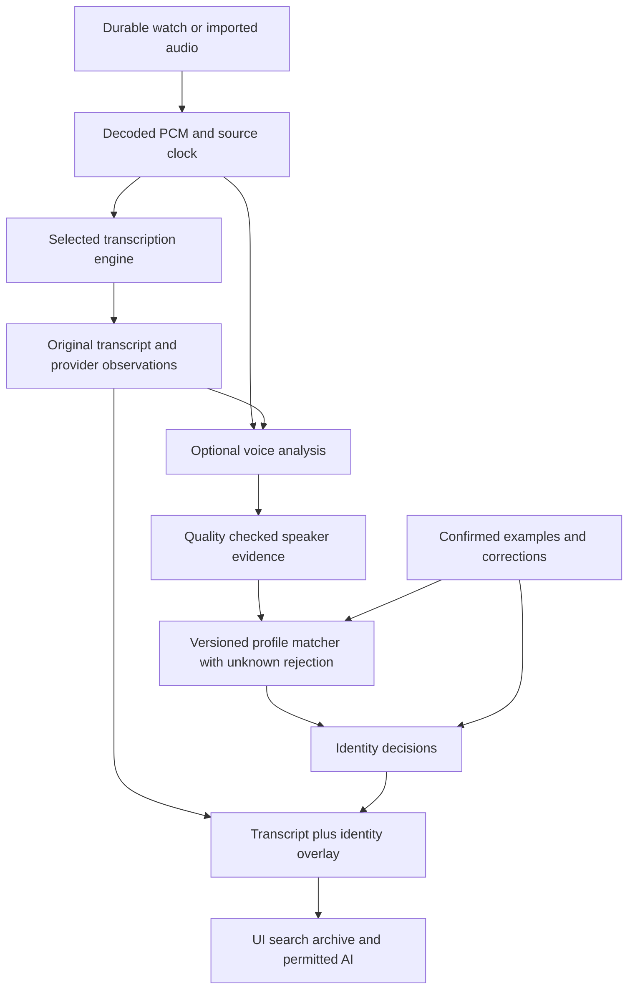

# Voice identification research and implementation plan

Research checked **2026-10-25** against 34 primary sources. The native iOS implementation now uses a separate, optional voice identity layer. The research and longer-term product design below explain the choices and identify future extensions; they are not a claim that every proposed feature has shipped. Licensing evaluation is deferred at the user's direction.

Build an **optional voice identity layer owned by Pebble Audio**, independent of transcription and AI. People can enroll their own voice, remember other people, correct an audio passage, and find voices in retained recordings without changing transcription providers. Manual naming remains useful with recognition off. A wrong confident name is worse than an unnamed speaker.

## Implementation status — October 25, 2026

### Implemented in native iOS

- **Actual local inference:** pinned CoreML Community-1 speech/overlap segmentation and Cactus WeSpeaker ResNet34-LM FP16 embeddings, with explicit unknown rejection. Approximately 18.34 MB of models download only when requested. Model files are revision/SHA checked, installed atomically and excluded from backup. The pretrained encoder stays fixed; confirmed examples update a person's profile without a per-person neural-network training job.
- **People & voices:** default-off recognition, explicit current-user association, guided 20-second phone recording with microphone permission, listen/retry/save, voice profiles, grouped confirmed samples, removal/forget, and clear error/retry states. Existing watch passages are another enrollment route. Model preparation alone does not enable recognition; a successfully saved guided sample does. Voice material is encrypted with a device-bound key. Raw phone enrollment audio is discarded.
- **Corrections:** a bounded audio preview, a clip picker for naming a voice anywhere in a conversation's stored audio (one recording section at a time, 1–30 seconds, works without a transcript), manually named clips listed as “Chosen by you” beside recognized ones, stable-person picker, duplicate-name-safe creation/rename, explicit “This is me,” and “Leave unnamed.” Remembering a voice is separate from naming and explains that it will check retained history. A rejected training sample does not discard the manual name. Existing manual choices always outrank predictions; predictions never become training examples.
- **Honest timing:** one resolver serves transcript names, participants, search, Muse, app intents, new Ask requests, follow-up extraction and archive exports. Exact word-aligned names are used only with matching word evidence. With coarse timestamps the editor explicitly selects the full timed passage; it never guesses a displayed paragraph's acoustic boundaries. Independent audio matches have their own listen/correct UI when they cannot safely label words. All scopes respect conversation pieces, source-media clocks and gaps.
- **Bounded processing:** new closed audio and explicitly selected past-week/all-retained history use a persistent queue and discovery cursor. Work is limited to small foreground passes with thermal/suspension cancellation and no new periodic background task. History can stop and resume across launches; durable Undo preserves later manual corrections. Disabling stops new recognition while keeping existing names and profiles.
- **Deletion and race handling:** source deletion, redaction, correction of an example, forgotten profiles, model/key incompatibility and library wipe invalidate stale work. A missing device key disables recognition and clears derived private material while preserving ordinary people, manual names and audio. Temporary key lock does not destroy profiles.
- **Archives:** names-only patches preserve longer retained transcripts when the phone has only a recent audio tail. Stable person IDs support rename/delete. Automatic attributions carry source-device provenance and generation, and durable person/run/all revocations prevent delayed sync from resurrecting removed automatic names. Manual names, transcript words, gaps and unaffected retained prefixes are preserved.

### Evidence and release boundary

Reproducible model evaluation, immutable model revisions, public corpus IDs, threshold selection, codec tests and timing measurements are in [`ios/Tools/SpeakerEvaluation/README.md`](../ios/Tools/SpeakerEvaluation/README.md), with machine-readable results beside it. The native end-to-end test uses the production service, real models, encrypted profiles and actual watch-codec data; it is opt-in and reports a skip when its external corpus is unavailable. It must not be counted as passing merely because ordinary unit tests pass.

The immutable October 25 backup supplied 2,895 raw logs and 1,827 transcripts. We evaluated 40 bounded private crops from 10 segments locally. Those recordings establish decoding/inference behavior, **not identity accuracy**: the surviving legacy assignment is orphaned and supplies no reliable wearer ground truth. No person is silently enrolled from being loudest or most common, and no private recording was uploaded to a model vendor. Public labeled evaluation supplies the known/unknown comparisons. Phone-to-watch channel transfer and low-volume overlap are explicitly measured limitations, not inferred away from public verification scores.

Current release evidence and exact commits are recorded in the workspace [implementation progress log](../../UPSTREAM_THIRD_PARTY_BACKGROUND_AUDIO_IMPLEMENTATION_PLAN.md). Simulator tests and a signed Release build do not establish an installed or battery-validated phone release. G17 must be connected for installation and the required ten-minute/next-morning resource checks.

Production UI captures: [People & voices](mockups/voices/built/settings-phone.png), [guided setup](mockups/voices/built/setup-phone.png). These were captured by the separate `VoiceUITests` scheme while exercising the real app, local model installation, cancellation and persisted on/off state. Additional actual SwiftUI views were rendered at 375/820/1024 points and in dark/accessibility text, including [audio-only matches](mockups/voices/built/audio-matches-phone.png) and [large text](mockups/voices/built/audio-matches-large-text.png). The rendering harness is temporary; it is not a production screen or a substitute for device interaction tests.

### Deliberate boundaries

This delivery targets the active **native iOS companion**. Recognition works with local/cloud ASR routing, and without ASR, because it reads durable audio independently. It currently runs locally; no cloud recognition provider, voice-profile sync, live streaming identity, or Android voice-recognition UI is exposed. Ordinary archive sharing may include names under the existing archive setting, but never uploads voice embeddings. Profiles remain device-bound and require fresh enrollment after a device restore.

The longer-term UX below also proposes one-step merge/split of people, contact links, candidate suggestions, saved-answer staleness badges and more detailed per-condition evaluation. These are not in the current UI. Users can select and reassign precisely timed passages, pick any clip of up to 30 seconds from a conversation's stored audio and name its speaker (even with no transcript), preserve separate people with the same display name, remove bad confirmed samples and undo automatic history runs. Automated recognition can abstain or be wrong, especially with distant/overlapping speech; it is never authorization for Muse actions. Expired source audio cannot be newly analyzed. Untimed legacy labels cannot safely survive a provider's replacement speaker numbering; those labels are cleared with a diagnostic rather than reassigned to a different voice.

## 1. Separate the three problems

| Problem | Question | What it does not establish |
| --- | --- | --- |
| Diarization | Which voice spoke during each interval? | A person's identity across recordings |
| Voice identification | Does this voice match an enrolled person, or nobody we know? | The words spoken, live presence, or authorization |
| Word attribution | Which spoken words overlap each person's speech? | Certainty where timing is coarse or people overlap |

“Speaker 1” is an observation inside a particular diarization run. “Roger” is a persistent person. “You” is how the current user's person is displayed in their own app. None of these should be interchangeable database keys.

The desired experience is: identify a few clear passages, then useful names appear across recordings regardless of whether text came from Apple Speech, Parakeet, Soniox, OpenAI, or a future provider. Names may arrive after words. When confidence is insufficient, ordinary transcription and playback continue.

## 2. Current options and recommendation

These are capability and integration assessments, not a ranking of measured watch-audio accuracy. Public verification error rates and diarization error rates measure different tasks and cannot be compared as a single “accuracy” number.

### Local and self-hosted candidates

| Candidate | Relevant capability | Deployment and licensing | Role in our evaluation |
| --- | --- | --- | --- |
| **Cactus + WeSpeaker ResNet34-LM** | Extracts 256-dimensional speaker embeddings from 16 kHz PCM; optional speaker masks | The app's actual iOS binary exports the embedding function. Current/v1.14 runtime has a custom commercial license; converted model card is CC-BY-4.0 | First embedding baseline because the runtime is already bundled |
| **FluidAudio + WeSpeaker / Community-1** | Swift/CoreML diarization and extraction of embeddings from supplied speech spans | Apache-2.0 SDK; current Community-1 model artifacts CC-BY-4.0, with separate provenance for older assets | Strong iOS candidate; particularly useful with both diarizing and non-diarizing ASR |
| **pyannote Community-1** | Full offline segmentation, embeddings and clustering, including an exclusive diarization view for aligning text | Python/PyTorch; pipeline weights CC-BY-4.0; offline after download | Reproducible reference and possible own-server engine |
| **NVIDIA Nemotron-3-Diarization** | Streaming/offline diarization, up to eight anonymous speakers; released September 23, 2026 | OpenMDW-1.1 weights; NeMo and native runtime options | Later streaming/server comparison; requires an additional identity matcher |
| **sherpa-onnx + WeSpeaker/CAM++/3D-Speaker** | Mobile speaker embeddings and diarization, Swift/Kotlin/native interfaces | Runtime and chosen checkpoint licenses must be checked separately | Cross-platform alternative, particularly for Android |
| **SpeechBrain ECAPA / NVIDIA TitaNet** | Established standalone speaker embedding models | ECAPA model card Apache-2.0; TitaNet model card CC-BY-4.0 | Alternative encoder controls if WeSpeaker is inadequate |
| **Picovoice Eagle 3** | Packaged enrollment and streaming speaker recognition on mobile | Commercial engine; internet required for AccessKey validation according to its repository | Commercial comparison if integration/support benefits justify dependence |

Primary sources: [Cactus FFI](https://docs.cactuscompute.com/v1.14/docs/cactus_engine/), [Cactus weights](https://huggingface.co/Cactus-Compute/wespeaker-voxceleb-resnet34-LM), [Cactus v1.14 license](https://raw.githubusercontent.com/cactus-compute/cactus/v1.14/LICENSE), [FluidAudio guide](https://github.com/FluidInference/FluidAudio/blob/main/Documentation/Diarization/GettingStarted.md), [FluidAudio SDK license](https://github.com/FluidInference/FluidAudio/blob/main/LICENSE), [CoreML model provenance](https://huggingface.co/FluidInference/speaker-diarization-coreml), [Community-1](https://huggingface.co/pyannote/speaker-diarization-community-1), [Nemotron model card](https://huggingface.co/nvidia/Nemotron-3-Diarization), [sherpa identification](https://k2-fsa.github.io/sherpa/onnx/speaker-identification/), [WeSpeaker model licensing](https://github.com/wenet-e2e/wespeaker/blob/master/docs/pretrained.md), [3D-Speaker](https://github.com/modelscope/3D-Speaker), [ECAPA](https://huggingface.co/speechbrain/spkrec-ecapa-voxceleb), [TitaNet](https://huggingface.co/nvidia/speakerverification_en_titanet_large), [Eagle](https://github.com/Picovoice/eagle).

**Cactus requires two checks before adoption.** Its bundled header and arm64 binary both contain `cactus_embed_speaker`; this establishes an integration opportunity, not a working feature. A separate embedding model must be loaded and tested. Its `cactus_diarize` implementation provides segmentation channels, which must not be mistaken for stable whole-recording identities; clustering and permutation handling still need validation. Audit the exact vendored runtime revision/license rather than applying today's license retroactively. Current v1.14 terms distinguish organizations with both revenue and funding below $2M from those requiring commercial licensing. [Runtime implementation](https://raw.githubusercontent.com/cactus-compute/cactus/v1.14/cactus/ffi/cactus_diarize.cpp), [license](https://raw.githubusercontent.com/cactus-compute/cactus/v1.14/LICENSE).

**FluidAudio offers a particularly useful seam:** `OfflineDiarizerManager.embedSpans(audioSource:spans:)` can reuse existing provider turns without rerunning segmentation/clustering. Its full offline path can supply turns when local ASR cannot. The authors report substantial memory variation with batch size; that is a reason to measure peak residency alongside our ASR engines, not to adopt desktop defaults. [Integration guide](https://github.com/FluidInference/FluidAudio/blob/main/Documentation/Diarization/GettingStarted.md).

### Managed services and existing transcription providers

| Service | What the current documentation establishes | Consequence for Pebble Audio |
| --- | --- | --- |
| **pyannote Precision-3 identification** | Dedicated audio identification using supplied voiceprints; `/identify` accepts 1–50 voiceprints and supports Precision-3, while its documented default remains Precision-2 | Best initial hosted comparator because identity need not replace our transcription provider; explicitly pin the evaluated model |
| **Speechmatics** | Cross-recording voice identifiers in batch, realtime and Agent STT; enrollment from 5–30-second solo clips; up to 50 identifiers total | Real identity capability, but closely integrated with its STT. Consider if evaluating another ASR provider; less attractive as a duplicate transcription pass |
| **Soniox** | Per-session speaker labels, with up to 15 speakers; streaming assignments can change and async diarization is recommended for accuracy | Reuse as anonymous observations; reviewed public docs do not establish a persistent enrolled-person registry |
| **OpenAI** | Legacy `gpt-4o-transcribe-diarize` accepts up to four named 2–10-second references; speaker labeling is file-transcription functionality, not Realtime transcription | Useful compatibility reference, unsuitable as our new identity foundation: officially deprecated for shutdown February 26, 2027. Do not assume replacement models preserve this API |
| **AssemblyAI** | Its named “Speaker Identification” infers names/roles from conversation content; its FAQ distinguishes this from cross-file voice registration | Contextual suggestions may help a picker, but must not become acoustic confirmation or training evidence |
| **Deepgram / ElevenLabs Scribe** | Current reviewed features provide within-recording diarization; Deepgram has different batch/streaming diarizer versions; Scribe v2 documents up to 32 speakers | Valid ASR/diarization sources, not evidence of portable enrolled-person recognition |
| **Legacy Azure Speaker Recognition / Amazon Connect Voice ID** | Azure's official lifecycle inventory lists retirement September 30, 2025; AWS ended Voice ID support May 20, 2026 | Exclude these old recommendations from a new design |

Sources: [pyannote identification API](https://docs.pyannote.ai/api-reference/identify), [Precision-3 release](https://www.pyannote.ai/changelog/precision-3), [Speechmatics identification](https://docs.speechmatics.com/speech-to-text/features/speaker-identification), [Soniox diarization](https://soniox.com/docs/stt/concepts/speaker-diarization), [OpenAI file transcription](https://developers.openai.com/api/docs/guides/speech-to-text), [OpenAI deprecations](https://developers.openai.com/api/docs/deprecations), [AssemblyAI identification](https://www.assemblyai.com/docs/speech-understanding/speaker-identification), [AssemblyAI cross-file FAQ](https://support.assemblyai.com/articles/4595780683-do-you-offer-cross-file-speaker-identification), [Deepgram](https://developers.deepgram.com/docs/diarization), [ElevenLabs](https://elevenlabs.io/docs/overview/capabilities/speech-to-text/), [Azure lifecycle inventory](https://github.com/Azure/EOL/blob/main/service_list.json), [AWS retirement](https://docs.aws.amazon.com/connect/latest/adminguide/amazonconnect-voiceid-end-of-support.html).

Speechmatics identifiers are tied to their model, customer and project, and must be regenerated after a model change. Changing those scopes can invalidate profiles without invalidating our person IDs; rotating a key within the same scope should not. Its realtime sensitivity setting also changes preference for enrolled versus new speakers; do not copy a demo setting as our unknown-rejection policy. [Identifier constraints](https://docs.speechmatics.com/speech-to-text/features/speaker-identification), [realtime controls](https://docs.speechmatics.com/speech-to-text/realtime/speaker-identification).

pyannote's enrollment guide requires a single speaker and at most 30 seconds; voiceprints affect identification rather than repairing diarization. The app supplies and stores the reusable voiceprints. Vendor documentation currently describes 24-hour job-output retention, up to 48 hours for uploaded media, selectable EU-only processing, and no use of customer data for model training. Confirm the selected transport, region and contract when implementing; uploading to our own VPS still means leaving the phone. [Enrollment](https://docs.pyannote.ai/tutorials/identification-with-voiceprints), [retention](https://docs.pyannote.ai/data-retention).

Enrollment adapters must respect different contracts. pyannote specifies one voiceprint per person, so select/compile a compliant input from our confirmed examples rather than generating a voiceprint per example. Speechmatics permits multiple identifiers per person. pyannote's default `matching.threshold = 0` and `matching.exclusive = true` also need explicit evaluation: the latter prevents several diarization labels matching one voiceprint, which matters when one person was split into several labels. Matching exclusivity is separate from overlap-free diarization. [pyannote matching guide](https://docs.pyannote.ai/tutorials/identification-with-voiceprints).

### Cost and operational fit

Compare **incremental recognition cost**, including an extra audio transfer, against reusing already-paid ASR observations. An always-recording app is not a weekly meeting recorder. At an illustrative eight submitted hours per day, a 30-day month is **240 audio hours**. Compute costs from actual submitted duration and provider minimums, plus enrollment, storage, retries and infrastructure; do not multiply by the much smaller amount of speech displayed in the UI.

pyannote currently advertises a €19/month Developer plan with usage credit; exact endpoint tariffs and commercial terms need checking when selecting the backend. Its billing policy has a 20-second minimum per successful diarize/identify/live job and charges voiceprints per creation. Batch meaningful bounded spans rather than submitting each “yes” separately. [Pricing](https://www.pyannote.ai/pricing), [billing](https://docs.pyannote.ai/administration/billing).

Local inference removes per-minute cloud billing but adds model distribution, phone energy, memory and thermal costs. Own-cloud inference adds queueing, compute utilization, maintenance, secrets and deletion responsibilities. The existing archive server is not evidence that it has suitable GPU capacity. Eagle's local inference still needs its license-network behavior tested in airplane mode and after cold start.

## 3. Original integration audit (before implementation)

The active iOS implementation is native SwiftUI/Swift under `ios/`, with Apple Speech and selectable Parakeet (Cactus/Core AI), Soniox/OpenAI batch, and live providers. The old KMP speaker store is not a shared acoustic-identity system. Android needs the same semantic contract with an appropriate native adapter; a Swift-only implementation must not be reported as Android support.

| Existing seam or defect | Evidence in the current repository | Required change |
| --- | --- | --- |
| Decoded Speex PCM already exists | `TranscriptionProcessor.segmentPcmSource` in `ios/PebbleAudioKit/Sources/Transcription/TranscriptionProcessor.swift` | Read durable audio through a separate recognition job; never block BLE receive or audio persistence |
| People and manual assignments already exist | `PeopleStore`, `Person`, `SpeakerKey` in `ios/PebbleAudioKit/Sources/AppDB/Stores.swift` | Preserve people, add explicit self role, range-level corrections and voice profiles |
| “You” is inferred from literal name | `ios/App/Runtime/TranscriptItems.swift`, `speakerRole` | Use `currentUserPersonId`; localize presentation independently |
| Rename can silently merge same-name people | `PeopleStore.renamePerson`; assign-by-name in `LiveLibraryDataSources.swift` | Allow duplicate names; make merge explicit, previewable and reversible |
| Existing speaker scope is segment + provider label | `SpeakerKey`; `SpeakerRenameSheet` in `TranscriptView.swift` | Include provider run/request/chunk revision; default corrections to selected speech |
| OpenAI synchronous requests concatenate raw speaker labels | `Providers/OpenAiTranscriptionProvider.swift`, `transcribe` and chunk parsing | Namespace labels per request/chunk; do not assume A in successive requests is the same person |
| Retranscription replaces turns while assignments survive | `Services/TranscriptionService.swift`; `TranscriptionProcessor.swift` | Preserve human decisions by audio spans, then conservatively realign new text |
| Local ASR may supply no speaker label | Local providers and `TranscriptItems.swift` | Unlabeled speech must not share one global empty-string identity; run independent diarization when needed |
| Cloud-mode predicate also enables speaker labels | `CompanionRuntime/RuntimeSettings.swift` | Recognition gets its own explicit setting and provenance |
| Naming writes can dismiss despite failure | `SpeakerRenameSheet` save paths in `ios/App/Screens/Conversation/TranscriptView.swift` | Durable save before success; keep the sheet open with actionable retry on error |
| Archive/search currently render resolved names | `ArchiveExport.swift`, `ArchivePayloadBuilder.swift`, `ArchiveOutbox.swift`, `LiveLibraryDataSources.swift` | Consume one identity overlay and invalidate on its revision |
| Follow-up prompts currently use raw speaker labels | `ios/PebbleAudioKit/Sources/Intelligence/FollowUps.swift` | Carry person, self role, uncertainty and source span separately from task ownership |

Conversations are **pieces of segments**, and may split/join or change provisional boundaries. Use the existing `ConversationPieces` clipping and `SegmentMediaClock` conversion. Stored media time excludes missing or suppressed intervals; two adjacent samples in a file can be separated in real time. Never build an enrollment window across a loss, VAD discontinuity, deletion, or person change. See [conversation units](conversation-units.md).

Existing Cactus privacy configuration disables telemetry/cloud handoff before initialization (`Local/CactusPrivacyConfiguration.swift`). Any new embedding model handle must pass through that same protection. Verify actual network behavior for every local runtime; an SDK label saying “on-device” is insufficient.

## 4. Product design and further UX extensions

Follow the accepted [native redesign decisions](redesign/2026-08-30-direction-decisions.md): short flows, direct controls, no new top-level tab or mandatory setup ceremony.

### Places this lives

- **Settings → People & voices:** recognition Off / On this phone / chosen cloud destination; You; other people; download/status when relevant.
- **About You → Your voice:** links to the same profile. Written personal context is not voice enrollment.
- **Tap a speaker in a transcript:** listen, identify, correct, choose scope, optionally remember their voice.
- **Person detail:** their conversations, examples, improve/forget voice, rename, merge, split and delete.
- **Search:** people filters and “What did I say?” use the same resolved identity.

Normal transcript headers remain quiet. Details expose **Named by you**, **Recognized**, **Possible match**, **Unknown speaker**, or **Several people**. Put uncertain candidates in the picker or optional review list rather than displaying them as settled names. Do not show uncalibrated percentages.

### Set up your own voice

1. Offer **Recognize my voice** after the watch is usable, or when the person taps **This is me**. **Not now** leaves the app fully functional and suppresses repeated prompting.
2. Offer **Use a recording** and **Speak now**. For existing speech, start with a passage the user selects and confirms. Loudest voice, first speaker and push-to-talk are not proof of ownership.
3. Prefer the watch microphone worn normally. Offer a neutral prompt or “Tell me about your day”; exact wording and language should not matter. Existing audio is an equal first-class route for people who cannot or do not want to read aloud.
4. Accumulate clean, single-speaker speech. A prototype target might be 20–40 seconds spread across useful examples, but duration is a tuning hypothesis, not an accuracy promise. Silence, clipping, overlap and gaps do not fill the progress indicator. Give one concrete instruction at a time.
5. Check against a different short sample, not the same samples used to construct the profile. Save progress when interrupted. Say **Ready to recognize your voice** only after the chosen quality gate; otherwise **A little more speech will help**.
6. Finish with **Use for new recordings** and an optional **Find me in older recordings** action. Start historical matching with a visible recent scope, for example the last seven days of available audio, and offer a wider date range. This scope is a proposed default to validate in usability testing.

The self person exists without acoustic enrollment. A proper name, a localized “You,” or a contact rename never changes its identity. Exactly one person is the current user within an active app profile; changing that association is explicit and does not relabel another account's history.

Enrollment states survive navigation/process interruption: not started, collecting, paused, partial saved, ready, needs more examples, model unavailable. A call or watch disconnect preserves accepted fragments. If capture is off, **Start sample** must explicitly start a bounded capture and restore the previous capture intent on completion/cancel; until this lifecycle is implemented, use existing recordings or explain the recording prerequisite. Never silently leave recording enabled. A phone-microphone option has its own permission and remains a different acoustic source.

### Correct a passage and teach the app

Tap a speaker header → **Who's speaking?** → short audio preview, **You**, recent people, search, **New person**, **Leave unnamed**. Cancel leaves the current assignment unchanged; Leave unnamed clears it and records a manual lock.

The default scope is **This passage**. **More of this speaker in this conversation** opens a reviewable selection. An entire storage segment or every use of “Speaker 1” is never an implicit scope. For a mixed passage, **More than one person** allows splitting at audible/word boundaries; provide accessible buttons as well as drag handles.

Naming saves the chosen audio-span assignment immediately and remains available with recognition off or source audio missing. **Use this voice to recognize Alex** is a separate choice. Once learning from confirmed corrections is enabled for Alex, show that state in the sheet and allow a name-only correction. Quality rejection does not prevent naming: “Named Alex. A clearer example is needed to recognize this voice elsewhere.”

For an incorrect automatic match, support **Someone else**, **Not Alex**, and **Leave unnamed**. Persist exclusions/locks so the next pass does not restore the same mistake. A manual choice outranks every automatic result. A suggestion based on text or a model's own prediction never qualifies as human confirmation.

When correction removes a bad enrollment example, remove its profile contribution and rescore dependent automatic matches. Do not let an inferred match train the profile which then “confirms” that same match. Several inconsistent examples should produce **These examples may contain different people**, with previews to repair them.

### Finding the same person elsewhere

After enrollment/correction, run bounded matching in the background within the user's enabled scope. History is rescanned only where historical matching was already chosen; naming someone or enabling learning never widens that scope. Automatically apply only accepted matches to unconfirmed speech. Show actual results: **Alex found in 8 conversations · Review · Undo**. Lower-confidence candidates stay unnamed; review is optional, grouped, and does not generate notification floods.

A history job displays evaluated/remaining items, matches, unavailable audio and deferred work separately. It can pause, cancel and resume. Existing iCloud audio is downloaded only under the chosen policy, not all at once. **No match** and **Audio no longer available** are different results.

Undo is durable, not merely a five-second toast. It reverses changes still owned by that batch, including its learning contribution where applicable, while preserving later user corrections. Persist a suppression for those historical spans/profile results so the next ordinary job cannot immediately reapply them; an explicit historical rerun can clear that suppression. Undoing historical matching does not accidentally turn off recognition for new recordings.

### Manage a person over time

| Action | Expected result |
| --- | --- |
| Rename | Display name changes everywhere; identity and voice examples stay the same; duplicate names allowed |
| Improve voice | Add a confirmed example for another room, distance, language or vocal condition |
| Remove an example | Rebuild that model-specific profile; invalidate dependent automatic matches |
| Merge people | Show affected examples/conversations, choose survivor, preserve conflicts for review, support undo |
| Split people | Move selected confirmed spans/examples to a different person; contested predictions become unnamed |
| Forget voice | Delete that person's enrollment/embedding material and stop matching; preserve manual name history; remove dependent automatic names by default |
| Delete person | Remove the person, voice material and named assignments; preserve recording audio and transcript words unless separately deleted |
| Turn recognition off | Stop new recognition and learning; retain existing attribution and profiles until separately forgotten |

Optional contact links are conveniences, not identity keys. Two Alexes can have short distinguishing notes. Contact permission loss or deletion must not erase a person's voice history. Changing who is “You” changes that association and presentation, never transfers voice samples or interval decisions. Deleting the current-self person requires explicitly resetting that association or choosing a replacement; forgetting their voice remains available independently. Merging into self requires choosing the surviving identity and reviewing conflicting examples; display-name collisions never do it implicitly.

## 5. Settings combinations and failure behavior

Recognition is independent of the existing LocalOnly / LocalFirst / RemoteFirst / RemoteOnly transcription router and of AI settings. Internally represent recognition execution, fallback permission and history scope separately; the main UI can remain three simple choices.

| Transcription state | Recognition off | Recognition on this phone | Recognition in selected cloud |
| --- | --- | --- | --- |
| Local only | Current text and manual names | Local diarization/embedding/matching | Local text plus separately authorized audio identification; privacy summary names cloud destination |
| Cloud only | Provider text and anonymous labels/manual names | Reuse provider observations, match locally; independently diarize if absent | Provider observations plus selected identity adapter, avoiding duplicate ASR when possible |
| Local first | Existing ASR fallback behavior | Identity stays local whichever ASR actually ran | Cloud identity uses its own permission/network policy, independent of ASR fallback |
| Remote first | Existing ASR fallback behavior | Same identity model across cloud/local text | Identity outage does not block local ASR fallback |
| Transcription not configured, or a future explicit off setting | Recording and playback continue | Audio-range identification can work without words | Audio identification only when deliberately enabled; do not implicitly enable transcription |

Local transcription is a statement about transcription, not permission to upload elsewhere. Any global “keep everything on this phone” control must override all cloud destinations. The combined Privacy summary must remain truthful when local transcription and cloud recognition are selected together. Never infer recognition consent from an existing Soniox/OpenAI key.

Cloud recognition failures leave manual/unknown labels and a resumable job. A local fallback is used only when enabled and when that profile has compatible local examples; an opaque cloud voiceprint cannot automatically become a local embedding. No failure silently uploads to another provider. Missing models, unsupported hardware, low storage and deferred background execution affect voice recognition only.

Switching Off or to local stops future recognition sends immediately but does not retract earlier uploads. Keep the previous destination and pending cleanup/retention visible until resolved. “On this phone” describes new processing, not a claim that all historical remote copies have disappeared.

Live speech is provisional. Avoid name flicker by waiting for enough evidence and keeping provisional assignments distinct from final ones. Do not delay live text while awaiting identity. Later segmentation can revise automatic assignments, never a manual lock. Recognition should have its own “waiting for charging,” “download required,” or “unavailable audio” state rather than borrowing “transcription failed.”

## 6. Processing architecture and persistence

Use separate `DiarizationProvider`, `SpeakerEmbeddingProvider`, optional hosted `IdentificationProvider`, and an app-owned `IdentityResolver`. Capability metadata describes timing granularity, overlap, streaming revisions, model space, maximum candidates, retention and execution destination. A provider may implement several capabilities; that does not make its person IDs canonical.

Read bounded audio windows after durable storage. Reuse decoder work opportunistically, without sharing a queue that can block capture. Prioritize explicit enrollment/correction, then recent speech, then historical backfill. Cache by immutable evidence and model recipe, not by whichever screen is open. Release heavy model state when idle; serialize high-memory local ASR/voice work where required. UI observers do no work off screen and publish nothing for unchanged state.

### Matching and learning

1. Use provider turns as proposals when available. Check purity/quality; a diarizer can merge different people. When absent, run a complete independent diarization path, not VAD alone. VAD detects speech, not speaker changes.
2. Exclude gaps, clipped/very short speech, known app playback and overlapping voices from enrollment initially. Keep overlap in the observation model even if the text display needs an exclusive view.
3. Extract embeddings using the pinned recipe. Store multiple representative confirmed examples/prototypes per person, bounded by quality and diversity. Do not blindly average contradictory examples or let one long recording dominate.
4. Compare against enrolled people with explicit unknown rejection. Require sufficient clean speech, an acceptance score, separation from the runner-up and consistency across examples. Calibrate on our actual watch domain, including absent enrolled people. Use a stricter policy for “You.”
5. Maintain separate transcription confidence, diarization confidence and identity confidence. An ASR word confidence cannot serve as a voice-match probability.
6. Keep positive human labels, negative associations and manual unnamed locks. Add/remove confirmed examples and recompute affected prototypes. Freeze encoder weights initially; reconsider domain adaptation only after evidence shows this simpler approach is insufficient.

For a small personal roster, exact comparison is simpler than adding a vector service. Large rosters may need candidate retrieval, but a cloud's 50-candidate limit must not become an arbitrary 50-person product limit. Preserve “none of these”; log candidate-set revision, and do not compare scores from separate candidate batches as though they were calibrated together. Context can rank candidates, never establish identity.

The entire recipe is versioned: encoder, preprocessing, quantization, segmentation and calibration. Equal vector length does not mean Cactus/CoreML embeddings are compatible. Test parity or maintain separate spaces. Model upgrades rebuild from retained authorized examples; if audio is gone, keep historical names and ask for a fresh example rather than silently mixing spaces.

These choices follow the distinction between verification and open-set identification and the importance of channel/language/duration variation in evaluation. [NIST SRE24 plan](https://www.nist.gov/system/files/documents/2024/06/11/NIST_2024_Speaker_Recognition_Evaluation_Plan.pdf), [VoxWatch open-set benchmark](https://arxiv.org/abs/2307.00169).

### Proposed records

| Record | Essential contents |
| --- | --- |
| `Person` | Stable UUID, display name, optional distinguishing note/contact link; explicit current-user association |
| `VoiceProfile` | Person, model space, generation, state, destination and provider account/project scope, learning preference |
| `VoiceEvidence` | Source asset, immutable audio revision, media range/channel, capture device/type/codec, discontinuities, quality/overlap, embedding recipe and provenance |
| `SpeakerObservation` | Diarization run + provider request/chunk, anonymous label, speech ranges, overlap and timing certainty |
| `IdentityDecision` | Audio span, person or unknown, manual/inferred/blocked status, score/margin, profile and candidate generations |
| `CorrectionEvent` | Before/after, scope, learning choice, exclusions, change batch, undo dependency |
| `RecognitionJob` | Bounded scope, progress, idempotency key, input/settings/profile/provider-scope generations, cancellation and retry state |
| Tombstones | Deleted person/evidence/ranges and generation; remote cleanup state where applicable |

No canonical decision is keyed only by conversation ID, turn index, text, name or raw speaker number. A human lock covers the selected acoustic interval, not newly expanded text after retranscription. If exact alignment is impossible, retain the correction with uncertain mapping; do not smear it over a full sentence. Untimed text can coexist with named audio intervals without invented word attribution.

Every job checks generations before dispatch and again in the commit transaction. Reject results after deletion, source redaction, profile changes, disable, provider-account/project changes, newer manual corrections or a conflicting processing run. Provider scope participates in cache and callback validation; credential rotation within a verified unchanged scope need not invalidate the profile. Authenticated/idempotent callbacks cannot resurrect tombstoned data. Concurrent edits and sync conflicts preserve user choices or surface a conflict instead of silently choosing the latest model output.

### Migration

Preserve existing people and manual assignments. Legacy labels lacking run provenance remain legacy manual metadata; they are not automatically enrolled examples. Materialize conservative audio-span anchors only where the existing transcript establishes them. Do not automatically designate a person named “You” as acoustically verified, or reinterpret all old labels with a newly downloaded model. Add one explicit **This is me** association and let users confirm samples. The old Android hash-of-label store needs a deliberate migration, not reuse as the new identity key.

## 7. Propagation through the rest of the system

One resolver produces person and provenance for every consumer. An identity revision participates in memoized view keys, archive hashes, search donation, participant lists and generated-content dependencies. Transactionally enqueue a coalesced update per affected conversation; a rename/backfill must not create an observer write loop or repeated full-library scans.

| Consumer | On a corrected identity |
| --- | --- |
| Transcript, participant list, person search | Update from the current overlay; keep original words and audio |
| Archive/server/connected assistants | Update permitted attributed text with identity status; never include embeddings by default |
| New Ask request | Use current identities, source spans and uncertainty |
| Saved Ask answer | Preserve the answer; offer current sources and a short stale-attribution indicator where material |
| Automatic summary/title/recap | Mark stale and selectively regenerate under existing AI/privacy policy |
| User-edited note/title | Preserve verbatim |
| Suggested follow-up | Re-evaluate attribution/ownership, preserving the person's review decision |
| Accepted reminder/calendar item | Do not silently rewrite or delete an action the user already approved |
| Existing export or external assistant conversation | Cannot be recalled automatically; update our source, disclose that copies may remain |

**Current archive retention limitation:** when leading pieces have expired from the phone, the existing archive exporter preserves the server's fuller conversation by skipping replacement with the remaining tail. A new speaker correction on that tail updates the phone, search, and direct Muse reads, but does not yet update that retained server copy. Supporting that safely needs a range-level archive patch/merge contract; replacing the whole server transcript with the phone's shortened copy would destroy retained history. Complete conversations still use the corrected export and identity revision. Do not claim every historical server copy has been refreshed.

“Who said it” is separate from “who should do it.” Even a strong self match does not turn a quote, joke, audiobook or someone else's request into the user's commitment. Recognition may improve follow-up evidence; it never authorizes Muse tools or actions. A voice match also cannot establish live presence or defeat replay/cloning.

Keep initial recognition updates independent of conversation boundaries. Speaker-change evidence could later improve the conversation segmenter, but requires its own evaluation against the existing yardstick and must respect user splits/joins. Avoid a feedback loop where a name change regroups conversations and regrouping changes the recognition evidence.

## 8. Privacy, storage and deletion

Extend the existing [shared privacy model](privacy-model.md) with the actual recognition destination and data types: audio snippets, enrollment clips, reusable voice representations, pseudonymous person IDs and any names actually sent. Prefer opaque person IDs in provider labels, resolving display names locally. Treat embeddings as personal voice data, not anonymous hashes.

The normal setup needs one short statement of destination; details belong in People & voices / Privacy. Naming a person does not enroll their voice. Enabling cloud ASR does not authorize a second vendor or voiceprint upload. Remembering other people is an explicit action subject to the user's applicable recording/consent context; do not silently build a permanent registry of every stranger heard.

Recommended storage contract:

- Guided enrollment creates a small, visible **Voice examples** collection with explicit retention until forgotten. It is separate from ordinary recording retention and counts toward storage. The setup states this plainly.
- Learning from an existing recording keeps provenance to that audio; do not secretly retain another indefinite raw-audio copy. Derived profile evidence may remain under the chosen voice-profile retention policy after routine audio expiry, but users can inspect/remove it. If reusable audio is required for an upgrade, request a new example or an explicit saved copy.
- Unconfirmed/unknown embeddings are a bounded processing cache tied to source retention, not a permanent stranger registry. Only deliberately confirmed profile evidence gets independent profile retention; deleting/expiring ordinary audio purges other cached acoustic evidence.
- Explicit deletion of source content removes its linked evidence and invalidates dependent predictions. Routine audio retention, which may intentionally preserve transcripts/profile data, has different clearly stated semantics.
- **Forget voice** immediately blocks reuse and removes local samples/embeddings/profile caches plus dependent automatic assignments. Manual naming survives. Queue remote cleanup and distinguish pending from verified completion.
- **Delete all recordings** includes the separately stored voice examples and derived evidence under its confirmation scope; **reset all app data** additionally removes people/settings. Audit the actual existing Delete All wording and cascade before rollout so no hidden biometric store survives.
- Transcript archive sync, iCloud cold audio and voice-profile backup are separate choices. Profiles stay off the archive/assistant APIs by default. Put biometric payloads in a separate protected store excluded from ordinary device backups, rather than embedding them in the normally backed-up AppDB; verify platform behavior. Do not assume app-sync settings control OS backup. Any future opt-in profile backup needs an explicit encrypted format, recovery policy and cross-device conflict handling. Manual names and nonbiometric references remain ordinary app data.
- No audio snippets, embeddings, person names or presigned URLs in ordinary diagnostics. Use bounded reason codes and aggregate counters. Audit native SDK telemetry before model initialization.

Deleting a partial conversation silences only its pieces today. Recognition must invalidate those exact spans, including cached embeddings, while preserving neighboring evidence. Cancellation cannot recall audio already submitted; provider retention/deletion state must be represented honestly. Test restore, delayed cloud callbacks and offline sync so deleted evidence does not return unnoticed. An old independent backup cannot be remotely erased; restore must reconcile available deletion records and require explicit re-enablement where consent state is uncertain.

## 9. Edge cases and expected behavior

| Case | Required behavior |
| --- | --- |
| One-word answer, laughter, whispering, singing | Stay unnamed when insufficient; do not force a match or enroll poor evidence |
| Two people overlap | Preserve multi-speaker/uncertain observation; no mixed enrollment example |
| One person split into several diarization labels | Same person may resolve across labels; manual fixes do not depend on numeric label identity |
| Two people merged into one provider label | Passage correction and splitting; no automatic cluster-wide confirmation |
| Similar voices, siblings/twins, many candidates | Conservative rejection; evaluation includes confusing negatives and people absent from enrollment |
| Illness, aging, vocal changes, multilingual speech | Several confirmed exemplars; no silent new person or automatic model retraining |
| Wrist under clothes, far speech, wind/traffic, clipping | Quality gating and useful unknowns; record capture provenance |
| Speex artifacts, missing frames, VAD joins | Decode the real codec path; split evidence at discontinuities |
| TV, podcast, speakerphone, synthetic or replayed self voice | May be acoustically similar; source context remains uncertain, no command authorization or passive enrollment |
| App plays a preview while watch records | Exclude known playback intervals from learning; offer headphones; do not secretly pause capture |
| Local ASR has no speaker labels | Independent voice segmentation; no empty-string grouping of all speech |
| ASR has no word timing / translated text | Attribute audio intervals; do not invent exact word speakers |
| ASR off / transcription still pending | Audio-range naming works; no forced transcription |
| Provider/model switch or retranscription | Keep human acoustic anchors; new observation namespace and compatibility checks |
| Conversation split/join/provisional regroup | Decisions follow their source spans through piece clipping |
| Watch lending, several watches or imported audio | Account/self association remains explicit; capture ownership is not evidence of speaker identity |
| Interrupted enrollment, phone call, process death | Save accepted fragments, restore capture intent, resume safely |
| Airplane mode, expired key, throttling | Existing ASR unaffected; known local policy or pending/unknown, no unauthorized fallback |
| Low power, heat, low disk, background suspension | Bounded jobs and honest deferred state; prioritize durable recording |
| Old audio deleted or iCloud unavailable | Existing named history may remain; distinguish unavailable from evaluated/no match |
| Same name, contact rename, language/localization | Stable UUIDs, explicit self role, no implicit merge |
| Bad example or contradictory corrections | Remove/reassign evidence, rescore only dependencies, keep manual conflicts reviewable |
| Off/delete during upload or matching | Stop new work and reject stale commits; remote cleanup tracked |
| Two devices or old backup restore | Version/conflict/tombstone reconciliation; no silent profile resurrection |
| User undoes after later manual edits | Revert only still-owned batch decisions; preserve later edits |
| Accessibility and inability to read a prompt | Existing-audio/free-speech routes, VoiceOver, Dynamic Type, non-drag selection, no color-only meaning |

The current live view already documents that phone playback can be re-recorded by the watch (`ios/App/Screens/Live/LiveTimeline.swift`). Enrollment preview is a real product contamination risk, not just an adversarial scenario.

## 10. Evaluation methodology and original delivery sequence

### First benchmark

Use a consented, locally held watch-audio corpus. Split enrollment, calibration and final test by recording session/day, with additional held-out people; never put adjacent fragments of one utterance into enrollment and test. Include genuine unknown speakers, not just comparisons among enrolled contacts. Keep the user's raw recordings outside git. Cloud test uploads require the chosen destination to be deliberately enabled for that corpus.

Run:

1. Cactus WeSpeaker on existing provider turns, verifying the shipped binary, model loading, exact preprocessing and quantization.
2. FluidAudio embeddings on identical turns, then its full diarization path for non-diarizing local ASR.
3. Precision-3 identification as the managed comparison.
4. Community-1 self-hosted reference; add Nemotron-3 for streaming/server needs.
5. ECAPA or TitaNet only if the first encoder family misses the required quality.

Report separately:

- Precision of accepted named matches, false “You” assignments, unknown rejection, and coverage at those precision levels. Include uncertainty intervals and errors per recorded hour; a model that labels almost nothing is not a success.
- Diarization error with the overlap/collar scoring convention declared, plus word-attribution errors. Score the embedding matcher using human-correct turns as well as provider turns to separate its errors from segmentation failures.
- Enrollment duration and retry rate; useful performance with one short sample versus diverse examples; correction effort per hour; backfill reversibility.
- Per-condition outcomes for the edge cases above, language and distance, and genuine unknown people. Public VoxCeleb EER is not a substitute.
- Cold/warm latency, peak memory alongside ASR, CPU time, incremental energy, heat, DB writes, background suspension/recovery, and model download size/failure.
- Actual submitted cloud seconds, per-job minimums, enrollment requests, latency distribution and monthly cost at observed usage.

Proposed acceptance direction is high precision with explicit abstention, with a stricter self threshold. Set numeric launch gates after the initial corpus establishes sample size and confidence bounds, before selecting a winning engine. Do not tune thresholds on the final test set. Re-run the same held-out corpus for model/preprocessing upgrades.

### Milestones with reviewable exits

| Milestone | Work | Exit condition |
| --- | --- | --- |
| **A. Correct identity foundations** | Stable self association; duplicate names and explicit merge; request/revision-scoped observations; selected-span naming; visible save failures; legacy migration | Manual naming works with every ASR mode and survives retranscription, split/join, partial deletion and failed writes |
| **B. Benchmark and select engine** | Local adapters and isolated harness, held-out corpus, licensing/model provenance, energy/network measurements | Evidence-backed runtime/recipe choice, measured thresholds and documented unsupported conditions |
| **C. Optional self recognition** | Off default; enrollment; local queue; unknown states; shared resolver, consumer invalidation, forget/delete propagation | Self recognition works end to end without changing capture/ASR choices; every enabled consumer sees current identity/provenance and deletions; no authorization side effects |
| **D. Other people and corrections** | Explicit learning, examples, negative decisions, merge/split, model/profile generations | Mistaken examples can be removed and subsequent results corrected without overwriting user decisions |
| **E. History at scale** | Scoped resumable backfill, durable undo/suppression, batched UI/search/archive/AI refresh, large-library deletion races | Historical changes propagate and undo safely; user notes and accepted reminders remain intact; no stale result resurrection |
| **F. Optional cloud and platform parity** | Chosen cloud adapter, independent destination controls, retention/cleanup, native Android integration | Settings/failure matrix verified; each platform's capabilities and costs honestly stated |

Do not defer deletion, cancellation, manual precedence or basic downstream consistency until after shipping self recognition. They are prerequisites within C; identity-aware source rendering and cache invalidation must reach every enabled consumer before automatic names are published. E adds historical scale, coalescing and batch undo rather than making earlier recognition correct for the first time.

### Verification matrix

Use focused unit/integration tests for audio-clock mapping, request label collisions, conservative remapping, self identity, negative/unnamed locks, duplicate names, profile rebuild, version mismatch, job idempotency, stale results and undo under later edits. Exercise real database migrations on a copy, not the phone's active library.

Run integration scenarios across all four ASR routing modes, local engine choices, cloud providers, AI off/local/cloud, identity off/local/cloud, unavailable models, no network, expired credentials and source deletion. Verify the **actual** destination, not just the selected label. Recognition off must schedule no extraction/matching, create no new embeddings and send no recognition traffic.

Visually inspect onboarding, recognition unavailable, mixed-speaker correction, duplicate names, partial enrollment, failed saves, profile deletion and backfill/undo on phone/tablet/desktop-width presentations with large type and light/dark appearances. Test VoiceOver and non-drag controls. Use realistic long names and missing audio.

After every eventual phone deployment, follow the workspace battery gate: `scripts/phone-cost-report.sh` at ten minutes and next morning, with separate MetricKit/system crash review and running-build attribution. Compare workload-matched enabled/disabled runs; plugged-in observations alone cannot establish battery drain. A failing gate requires rollback/profiling under the existing deployment procedure.

## 11. Design decisions and future comparisons

Adopt now: optional recognition; app-owned persistent people; explicit self identity; provider-independent audio evidence; manual corrections outrank inference; separate naming from learning; unknown is valid; no training from guesses; reversible history updates; shared privacy model; no use as authentication.

Decide from the benchmark: Cactus versus FluidAudio/default runtime, whether a cloud option materially improves the watch domain, required clean speech, conservative matching thresholds, model memory scheduling and feasible live latency. Validate the proposed recent-history default and correction scope with a usable prototype.

The implementation above combines stable people and audio-span decisions with an isolated, reproducible benchmark and the native runtime. Future engines must preserve these foundations rather than adding automatic names directly to provider speaker labels.
